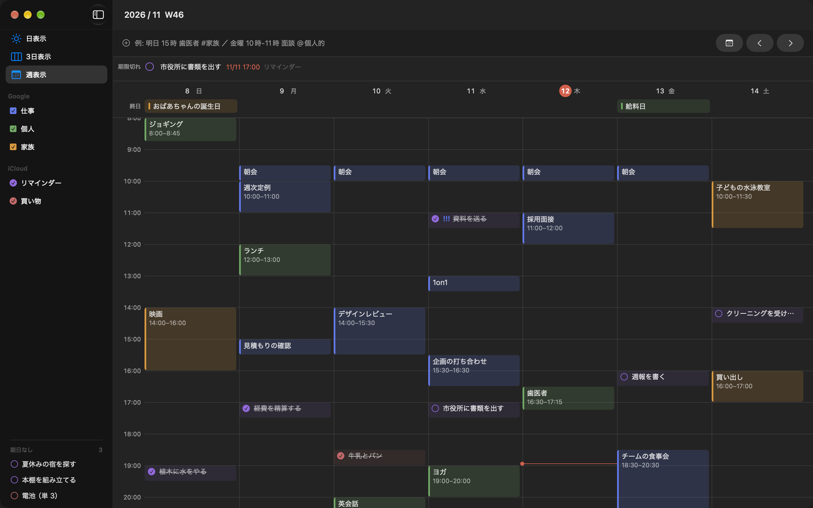

# Dayo

予定（Google カレンダーなど）と Todo（iCloud リマインダー）を 1 本の時間軸で確認・入力する Mac アプリ。
データは Mac に登録したアカウントのものを読み書きするだけで、独自のサーバーや保存先は持たない。



（画面の予定は見本です）

- 予定とリマインダーを同じ時間軸に並べる。日表示・3 日表示・週表示
- 日本語のクイック入力: `明日 15時 歯医者 #家族`、`金曜 10時-11時 面談 @個人的`
- キーボードで操作できる: 選択の移動、完了（`x`）、削除（`d`）、取り消し（`u`）など。`?` で一覧が出る
- ドラッグで日時の変更・長さの変更。期限切れのリマインダーと、期日なしのリマインダーも同じ画面に出す

## 使う

macOS 14 以降（Apple シリコン / Intel）。

1. [Releases](https://github.com/kowwwwji/dayo/releases/latest) から `Dayo-<版>.dmg` をダウンロードして開く
2. `Dayo` を `Applications` へドラッグする
3. 「アプリケーション」の Dayo を開く。初回は「開発元を確認できない」という旨の警告が出て開けないので、
   「システム設定 → プライバシーとセキュリティ」の下のほうにある「このまま開く」を押して、もう一度開く
   （Apple の有料の開発者登録をしておらず、Apple の確認（公証）を受けていないため。許可は最初の 1 回だけ）
4. カレンダーとリマインダーへのアクセスを許可する

予定やリマインダーは「システム設定 → インターネットアカウント」に追加したアカウントのものが出る
（Dayo のメニュー「アカウントを追加…」からも開ける）。表示の設定は Mac ごとに保存され、同期されない。

更新は、新しい dmg で同じように `Applications` へドラッグして置き換える（動いている Dayo は先に終了する）。アクセスの許可は引き継がれる。
不具合・要望は [Issues](https://github.com/kowwwwji/dayo/issues) へ。

## 開発

設計と画面・キー操作の仕様は [docs/DESIGN.md](docs/DESIGN.md)。

### ソースからビルドして入れる

必要なのは Xcode と `xcodegen`（`brew install xcodegen`）。

```sh
ghq get kowwwwji/dayo && cd "$(ghq root)/github.com/kowwwwji/dayo"
scripts/create-signing-cert.sh   # 最初の 1 回だけ。キーチェーンのパスワードを聞かれることがある
scripts/install.sh               # /Applications/Dayo.app へ入れて起動する
```

更新するときは `git pull` して `scripts/install.sh` をもう一度実行する（動いている Dayo は一度終了する）。

Apple の開発者登録をしていないので、その Mac だけで通用する自己署名の証明書で署名する。
毎回同じ証明書で署名しておくと、更新しても macOS が同じアプリと見なし、カレンダーとリマインダーの許可を聞き直されない。

### 新しい版を出す

dmg をこのリポジトリの Releases に置く。

```sh
scripts/make-dmg.sh   # build/Dayo-<版>.dmg を作る
gh release create v<版> build/Dayo-<版>.dmg --title "Dayo <版>" --notes "<変更点>"
```

版を上げるときは `project.yml` の `MARKETING_VERSION` と `CURRENT_PROJECT_VERSION` を上げてから作る。

### iPhone（試験的）

iPhone 版は作り込んでいない（ビルドが通るだけ）。無料の Apple ID（Personal Team）で署名して、つないだ iPhone へ入れることはできる。
最初に Xcode でその Apple ID にサインインし、iPhone の「設定 → プライバシーとセキュリティ → デベロッパモード」をオンにしておく。

```sh
scripts/install-iphone.sh   # iPhone をつないでロックを解除してから
```

初回は iPhone の「設定 → 一般 → VPN とデバイス管理」で開発元を信頼する。無料の署名は 7 日で切れるので、
切れたら同じコマンドで入れ直す。チーム ID は `project.yml` の `DEVELOPMENT_TEAM[sdk=iphoneos*]`（別の Apple ID で入れるなら書き換える）。

### Mac App Store

提出の準備（掲載文など）は [docs/app-store/README.md](docs/app-store/README.md)。今は出していない。

## ライセンス

[MIT](LICENSE)
